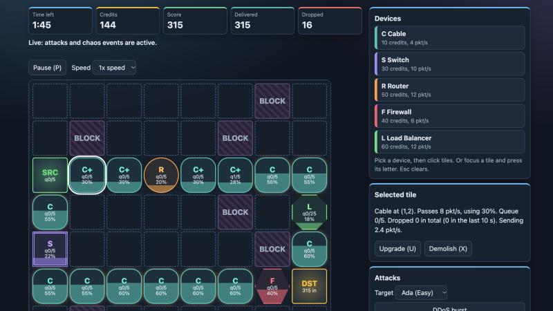

# Throughput

**Play it now: https://sharanya2015.github.io/Throughput/**



A small browser game that teaches **how to find a bandwidth bottleneck and balance load across parallel paths**.

You build a chain of network devices on an 8 x 8 grid to carry packets from a Source to a Destination, and compete against up to three bots for 3 minutes (Practice) or 10 minutes (Full). Every device shows how full its queue is and how much of its capacity is used, and the game tells you in plain language which device is the bottleneck and whether an upgrade helped.

**Status:** first playable version, **Solo vs Bots** only. Versus and Co-op against a Super Bot are designed but not built (see `docs/FULL-SPEC.md` and `docs/FULL-ROADMAP-TASKS.md`).

## Who it is for and what you learn

The player is a network engineer who repeatedly builds and repairs a chain of links and devices to carry packets, and gets better at finding bandwidth bottlenecks and balancing load across parallel paths because the game shows per-device utilization, queue fill and drops after every decision.

After a round you should be able to say: (1) a path is only as fast as its slowest device, (2) upgrading a link that is not the bottleneck changes nothing, (3) parallel paths that do not touch share load, while cables that touch merge traffic, and (4) queues overflow and drop packets when load exceeds capacity.

## Run it

You need Python 3 for a local web server (the game uses JavaScript modules, which browsers will not load from `file://`).

```sh
python3 -m http.server 8000 --bind 127.0.0.1
```

Open **http://localhost:8000** (or http://127.0.0.1:8000). Press Ctrl+C to stop. If port 8000 is busy, use 8001 in both places. On Windows: `py -m http.server 8000 --bind 127.0.0.1`.

## Controls

| Action | Mouse | Keyboard (focus a tile first) |
| --- | --- | --- |
| Place a device | Pick it in the Devices panel, click tiles | C Cable, S Switch, R Router, F Firewall, L Load Balancer |
| Move between tiles | Click | Arrow keys |
| Upgrade a cable | Upgrade button | U |
| Remove a device (50% refund) | Demolish button | X, Delete or Backspace |
| Pause | Pause button | P |
| Attack a bot | Attack buttons (unlock in the Live phase) | Tab to the buttons, Enter |

Click any tile once to put keyboard focus on the board. A first path that works: Cables on (1,2) to (7,2), then (7,3) and (7,4). That is 9 cables, 90 credits.

## The traffic model (what the tests check)

- Two devices are linked when their tiles share an edge. There is no wiring step.
- Every device passes at most its capacity per second (Cable 4, upgradable to 8 and 12; Switch 10; Router 12; Firewall 6; Load Balancer 12) and holds 5 waiting packets (25 for a Load Balancer). A packet that arrives at a full queue is dropped, and the drop is counted at that device.
- Packets move to a neighbour one step closer to the Destination. Cables and Firewalls take the first such neighbour (order up, right, down, left); the Source and Switches (3 ways) and Load Balancers (4 ways) take turns; Routers pick the shortest queue.
- Packets that move more than 12 times are dropped. Each delivered packet is +1 point and +1 credit.

Full rules, costs, chaos events, attacks and bots are in `specs/001-solo-vs-bots/spec.md`.

## Test it

Requires Node 22 or newer (only for tests; the game itself needs no Node).

```sh
node --test                                     # 50 unit tests, includes the three hand-checked fixtures
node scripts/head-to-head.mjs 100 practice      # one-on-one bot duels (SC-005)
node scripts/bots-vs-bots.mjs 100               # three-way bot rounds
```

### Verification notes (2026-11-17)

| Check | Result |
| --- | --- |
| `node --test`: 50 tests, 0 failed | **Passed** |
| Fixture 1 (correct case), 2 (wrong upgrade) and 3 (parallel paths, Firewall cap) | **Passed** (`test/fixtures.test.js`) |
| Replay determinism: same seed and commands give identical scores | **Passed** (`test/replay.test.js`) |
| Bot duels, 100 Practice rounds: Normal beats Easy 99%, Hard beats Normal 55%, Hard beats Easy 100% | **Passed** (SC-005) |
| Bot duels, 40 Full rounds: 100%, 83%, 100% | **Passed** |
| Three-way bot rounds, 100 Practice rounds: Normal wins 63%, Hard 37%, Easy 0% | Reported only. In three-way rounds the score leader draws everyone's discounted attacks, so Hard often loses ground there |
| Browser playthrough by the build agent (keyboard build, wrong upgrade message, results screen) | **Passed**, see `docs/PLAYTEST.md` |
| A second person playing without coaching | **Not done** |
| Playing with the network disconnected | **Not run** (no network calls found in the code) |
| GitHub Pages: loaded https://sharanya2015.github.io/Throughput/ and ran a round on it (2026-11-17) | **Passed** |
| Screen reader and phone layout | **Not run** |

## How it was built (Spec Kit)

Spec Kit CLI version `1.4.2.dev0` (installed with `uv tool install specify-cli --from git+https://github.com/github/spec-kit.git`), initialized with `specify init . --integration claude`.

| Artifact | Path |
| --- | --- |
| Inputs written for this game | `StarterKit/CONSTITUTION.md`, `StarterKit/SPEC.md`, `StarterKit/PLAN.md` |
| Constitution (v1.0.0) | `.specify/memory/constitution.md` |
| Specification with clarifications | `specs/001-solo-vs-bots/spec.md` |
| Plan | `specs/001-solo-vs-bots/plan.md` |
| Tasks | `specs/001-solo-vs-bots/tasks.md` |
| Analysis | `specs/001-solo-vs-bots/analysis.md` |
| Larger design for online modes | `docs/FULL-SPEC.md`, `docs/FULL-PLAN.md`, `docs/FULL-ROADMAP-TASKS.md` |

Honest note on process: the Spec Kit slash commands (`/speckit-constitution` and the rest) only load after restarting the agent in an initialized folder, which was not possible mid-session. The build agent followed each command's instruction file by hand and wrote the same artifacts. The `StarterKit/` files were not copied from the workshop repository (it was not available); they were written for this game.

## Known limitations

- Solo vs Bots only; no online play, lobby codes or Super Bot yet.
- Desktop browsers; no phone layout.
- Packets are not animated, only queue and utilization figures change.
- Bots are scripted and not tuned to be fair opponents in three-way games.
- Obstacles never block the two guaranteed paths along row 2 and column 7 and along column 0 and row 5.

## Credits

Game design, rules and code by the repository owner with Claude. Built with the Spec Kit workflow from the NAF workshop lab guide. The workshop's StarterKit and LICENSE files were not copied into this repository.
